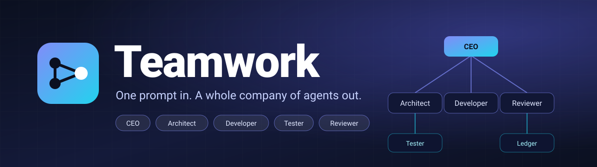
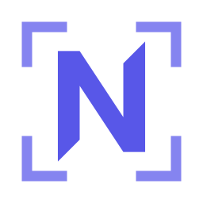

<div align="center">
  
  
  <h1>Nidvue Teamwork</h1>
  <p><strong>One prompt in. A whole company of agents out.</strong></p>
  <p>An autonomous, self-organising multi-agent company for coding agents:<br>
  evidence-gated, role-shared, and auditable by design.</p>
  <p>
    <a href="https://github.com/Nidvue/Teamwork/actions/workflows/ci.yml"></a>
    <a href="LICENSE"></a>
    <a href="docs/guide/architecture.md"></a>
    <a href="docs/guide/install.md"></a>
    <a href="CONTRIBUTING.md"></a>
    <a href="https://github.com/Nidvue/Teamwork/stargazers"></a>
  </p>
</div>

<p align="center">
  
</p>

Nidvue Teamwork is **a skill for your coding agent** - not a standalone
application. Install it like any other skill (one clone, no package manager), then
ask your agent for the team:

```text
> use the teamwork skill: Build a URL shortener with a CLI, tests and docs
```

That prompt becomes a team of AI agents that plans, builds, tests and
**independently reviews its own work until every acceptance criterion has
executed evidence**. The agent host supplies the LLM API, and **every agent's model
is configured independently** (`teamwork model set <agent>`): a strong model for
the Reviewer, a cheap one for the mechanical lanes. The engine (`teamwork.py`,
standard library only) ships inside the skill and is what the CEO calls;
installing it as a package is optional.

- **Developed by AI agents, for AI agents.** This repository is built by its own
  team: reviewed tasks in [Archive](docs/Team/Archive.md), the learning loop in
  [Evolution](docs/Team/Evolution.md), and all but two commits (a merge and a
  dependabot bump) by a role mailbox.
- **One prompt in, a whole company out.** [The 30-second quickstart](#30-second-quickstart)
  is the entire install.
- **It improves from its own failures.** A failure becomes a lesson, a lesson
  becomes a skill, and a skill reaches the core only after two cuts; the
  `tw-self-evolve` close-out checks the known issues, every verdict and the ledger
  chain. Its own verdict is `confounded`, because the first adoption changed the
  metrics and the classifier together ([Evolution](docs/Team/Evolution.md) 9.2).

## What makes it different

| Differentiator | What it is | Why it matters | Proof |
|---|---|---|---|
| **Skill-first** | One clone into the directory your agent scans; no package manager, no daemon, no service of ours. | It installs where the agent already looks, and the engine runs offline. | [Installation](docs/guide/install.md) |
| **One parent, one board** | Every role has exactly one manager and one queue; any role scales to several instances. | Parallel lanes do not create a second reporting line, and two lanes never share a writer. | [How it works](docs/guide/how-it-works.md) |
| **Evidence or `UNVERIFIED`** | A task cannot reach `done` without a recorded `command @revision -> result`. | The team does not ask an agent whether it is finished; it reads the records. | [Operations](docs/guide/operations.md) |
| **Reviewer-only merge** | The author self-checks, a different role reviews, and a pass lands at once. | The verifier is never the author, so "done" is not self-approved. | [How it works](docs/guide/how-it-works.md) |
| **Layered tests** | Each role designs, builds and runs its own layer; `tests plan` shows gaps. | Coverage is owned, not delegated to one suite. | [Features](docs/guide/features.md) |
| **Tamper-evident ledger** | Every mutation is hash-chained, and `ledger export` writes a manifest anyone can verify. | The audit trail survives modification and does not require trusting the team. | [Operations](docs/guide/operations.md) |
| **Self-evolution, measured honestly** | Failures become lessons, then skills; promotion to the core needs two cuts. | The loop is real work with a rollback, not a claim of measured improvement. | [Evolution](docs/Team/Evolution.md) |

Other orchestrators differ; the sourced comparison is in
[Alternatives](docs/guide/alternatives.md).


## Install the skill

Clone the skill into the directory your agent host scans - no daemon, no hosted
service, nothing to build:

```bash
# project-local: plain files in your repository, not a nested git repo
mkdir -p .agents/skills
git clone --depth 1 https://github.com/Nidvue/Teamwork.git .agents/skills/teamwork
rm -rf .agents/skills/teamwork/.git
```

Prefer a user-level install (`~/.agents/skills/teamwork`), a package manager
(`npm install @nidvue/teamwork`) or the optional engine wheel? [Installation](docs/guide/install.md)
compares all four channels, their commands and their requirements. Dropping the
nested `.git` is deliberate: the skill must be committed as plain files, not a
gitlink.

## 30-second quickstart

```bash
# 1. create the project and install the skill into it (one clone, nothing to
#    build; drop the nested .git so the skill is committed as plain files, not a
#    submodule)
$ mkdir my-project && cd my-project
$ mkdir -p .agents/skills && git clone --depth 1 https://github.com/Nidvue/Teamwork.git .agents/skills/teamwork && rm -rf .agents/skills/teamwork/.git

# 2. ask your agent for the team, from the project root
> use the teamwork skill: Build a URL shortener with a CLI, tests and docs
```

The CEO writes `AGENTS.md`, staffs the roster, freezes the interfaces, records
the acceptance criteria and opens the lanes. The hidden, gitignored workspace
appears at `.pi/Teamwork/Teams/<Team>/`; project output is committed. Read the full walkthrough in [Quickstart](docs/guide/quickstart.md).

## What you get

- **16 role charters** - the 15-role org plus a Team Leader per feature, each
  with its own memory and queue.
- **A two-stage quality gate** - the author self-checks with a real test, then a
  different role reviews the revision, and only the Reviewer merges.
- **Parallel lanes against one frozen contract** - interfaces first, then
  developer, tester and designer work at the same time.
- **Layered tests with one owner per layer** - `tests plan` shows coverage and gaps.
- **Portable and dependency-free** - CPython 3.11-3.13 on Linux, macOS and Windows,
  standard library only, with automatic model routing (`teamwork model auto`)
  across every lane.

## Documentation

| Page | Read it for |
|---|---|
| [Documentation home](docs/index.md) | The docs site index and repository links. |
| [Installation](docs/guide/install.md) | Four install channels, requirements, update, uninstall. |
| [Quickstart](docs/guide/quickstart.md) | Bootstrap a team in an empty project and run the CEO loop. |
| [For agents](docs/guide/for-agents.md) | The install-and-drive routine an agent follows. |
| [Usage patterns](docs/guide/usage.md) | The eight recurring jobs, as trimmed real transcripts. |
| [Operations](docs/guide/operations.md) | Slots, the memory pen, resume, the ledger, model routing. |
| [How it works](docs/guide/how-it-works.md) | The loop, the review gate, the workspace tree. |
| [Features](docs/guide/features.md) | Every capability, and what the evidence gate refuses. |
| [Architecture](docs/guide/architecture.md) | Package layout, resource resolution, workspace format. |
| [CLI reference](docs/guide/cli.md) | Every command, subcommand, flag and exit code, split into [records](docs/guide/cli-records.md), [review](docs/guide/cli-review.md), [workflow](docs/guide/cli-workflow.md) and [audit](docs/guide/cli-audit.md). |
| [Alternatives](docs/guide/alternatives.md) | How this compares with other orchestrators. |
| [Roadmap](docs/guide/roadmap.md) | What is shipped, current, and not planned. |
| [Releases](docs/releases.md) | What a release publishes and how to read its version. |
| [CI pipeline](docs/guide/ci.md) | Run the lint/test/build/docs pipeline locally. |

## Contributing, security and license

- **Contributing** - work on your own branch, run `pytest -q` and `ruff check`,
  and open a PR; a Reviewer - never the author - merges it. Read
  [CONTRIBUTING.md](CONTRIBUTING.md) and the [code of conduct](CODE_OF_CONDUCT.md).
- **Security** - report vulnerabilities privately via
  [GitHub security advisories](https://github.com/Nidvue/Teamwork/security/advisories/new);
  see [SECURITY.md](SECURITY.md).
- **License** - [AGPL-3.0-or-later](LICENSE) (version 3 of the AGPL or any later version), copyright (C) 2026 **Nidvue** (see [NOTICE](NOTICE)). The strong copyleft is deliberate: this is a
  governance tool, and its audit guarantees should survive modification.
- **No personal data, no local leakage** - no names, emails, home paths,
  credentials or agent-host state in the tree or history; `scripts/privacy_scan.py`
  fails the build on any of them.

<p align="center">
  <a href="https://star-history.com/#Nidvue/Teamwork&amp;Date"></a>
</p>
