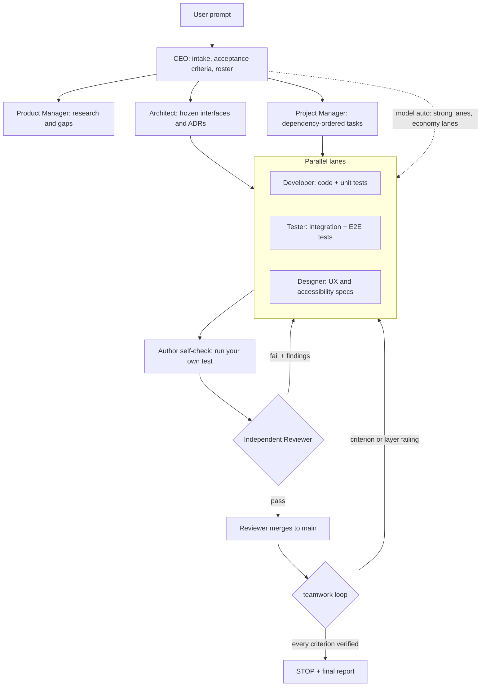

<div align="center">
  
  
  <h1>Nidvue Teamwork</h1>
  <p><strong>One prompt in. A whole company of agents out.</strong></p>
  <p>An autonomous, self-organising multi-agent company for coding agents:<br>
  evidence-gated, role-shared, and auditable by design.</p>
  <p>
    <a href="https://github.com/VisionPZ/Teamwork/actions/workflows/ci.yml"></a>
    <a href="LICENSE"></a>
    <a href="docs/Team/Architecture.md"></a>
    <a href="docs/guide/install.md"></a>
    <a href="CONTRIBUTING.md"></a>
    <a href="https://github.com/VisionPZ/Teamwork/stargazers"></a>
  </p>
</div>

<p align="center">
  
</p>

Nidvue Teamwork is **a skill for your coding agent** - not a standalone
application. It turns one prompt into a team of AI agents that plans, builds, tests
and **independently reviews its own work until every acceptance criterion has
executed evidence**. The agent host supplies the LLM API, and **every agent's model
is configured independently** (`teamwork model set <agent>`): a strong model for the
Reviewer, a cheap one for the mechanical lanes. The engine (`teamwork.py`, standard
library only) is the tool the skill calls; installing it as a package is optional.

```console
$ teamwork init --agents ceo,architect,product-manager,project-manager,reviewer-1,developer-1,tester-1
```

## Why Teamwork

| # | Differentiator | What it means in practice |
|---|---|---|
| 1 | **Evidence or `UNVERIFIED`** | A task cannot reach `done` without a recorded `command @revision -> result`. `teamwork loop` refuses to report `STOP` while any criterion or required test layer is unverified. "Looks done" is not a state. |
| 2 | **Role-shared memory** | Memory and the priority queue belong to the **role**, not the instance (`Roles/Developer/` is shared by `Developer-1..N`). Agents reuse verified facts instead of re-asking, and the CEO pulse feeds every idle lane. |
| 3 | **Hash-chained audit trail** | Every mutation is appended to `Ledger.jsonl` with `by` / `src` / `rev` provenance. `ledger verify` detects tampering, `trace T-0007` follows a claim end to end, and `ledger export` writes a manifest anyone can check without trusting the team. |

## Features

| Feature | What you get |
|---|---|
| Autonomous org | 15 role charters - CEO, CTO, COO, CFO, Architect, Product Manager, Project Manager, Designer, Developer, Tester, Release Engineer, Technical Writer, Data Engineer, Reviewer, Security Auditor. |
| Two-stage quality gate | The author self-checks with a real test, then a **different** role reviews from scratch. Only the Reviewer may merge. |
| Parallel lanes | Freeze interfaces first, then developer, tester and designer lanes run concurrently against one frozen contract. |
| Layered tests | Each role designs, builds and runs its own test layer (`unit`, `integration`, `acceptance`, `ui`, `security`, ...); `tests plan` shows coverage and gaps. |
| Designed images | The Designer owns every visual asset, raster **and** vector, and decides what the deliverable needs: vector first (SVG, diagram-as-code), and for a raster `imaging probe` picks the best available text-to-image model (cloud first, else local, else SVG), then plan -> 4+ candidates -> visual review -> improve until it passes -> integrate, with privacy and licence rules. |
| Stop condition as a record | Acceptance criteria are machine records, not checkboxes. The loop stops only when they are all verified. |
| Role-shared state | One memory and one priority queue per role; a private, disposable workspace per instance. |
| Concurrency control | Provider slot leases respect per-provider caps, so N agents never overload a model endpoint. |
| Disputes and tribunal | A challenged design goes through evidence rounds; a 3-round deadlock is ruled on by the CEO + CTO + CFO and recorded. |
| Portable, dependency-free | CPython 3.9-3.13 on Linux, macOS and Windows. **Zero third-party runtime dependencies.** |
| Enforced standards | One canonical toolchain per language, run by the team and gated in CI: `ruff format` + `ruff check` + `mypy` here, with the full per-language table in `references/Engineering.md`. |
| Automatic model routing | `teamwork model auto` detects the agent host (pi / claude / opencode / codex / cursor / gemini) and routes the strongest available model to the decision lanes and the economy model to the mechanical lanes - best output where it compounds, lowest cost where it does not. Every lane's model is configurable independently (`model set <agent>`). |
| Clean, modular history | Work commits are rebased and squashed before review, feature work squash-merges into `main`, and the naming policy (PascalCase directories, ecosystem-correct files) is written down rather than argued about. |
| Works as a skill and a package | Load it as a skill in Pi, Claude Code or opencode (`SKILL.md`), or as `AGENTS.md` in Codex, Cursor, Windsurf, Gemini CLI and Aider - the same protocol on every host (`references/Adapters.md`). |
| Remote-agnostic integrity | Branch protection, required checks, squash-only merges and protected `v*` tags are enforced on GitHub, GitLab, Bitbucket, Gitea/Forgejo or Azure DevOps alike. |

## Install

Requires Python 3.9 or newer. There are no runtime dependencies.

```bash
# pipx - isolated CLI, put on PATH (recommended)
pipx install teamwork-agents

# uv - run without installing
uvx --from teamwork-agents teamwork --version

# pip
python -m pip install teamwork-agents

# from source
git clone https://github.com/VisionPZ/Teamwork.git
cd Teamwork && python -m pip install .
```

Run it straight from a checkout without installing anything:

```bash
python3 scripts/teamwork.py --version    # teamwork 1.0.0
```

> The distribution name is `teamwork-agents` (the name `teamwork` is taken on
> PyPI); the import name and the console script are both `teamwork`. PyPI
> publishing is prepared but not enabled for this release - until then, install
> from the [GitHub release](https://github.com/VisionPZ/Teamwork/releases) wheel
> or from source.

## 30-second quickstart

```bash
$ cd my-project
$ teamwork init --agents ceo,architect,product-manager,project-manager,reviewer-1,developer-1,tester-1
$ teamwork agents-md     # write or patch the AGENTS.md constitution
$ teamwork map           # confirm the workspace and repo layout
$ teamwork criteria list # the machine records that define "done"
```

`init` creates the hidden, gitignored workspace at
`.pi/Teamwork/Teams/<Team>/` and leaves your project tree untouched. Project
output (`AGENTS.md`, code, tests, docs) is committed; team state is local.

If you use the Pi coding agent, the whole company is one command:

```text
/teamwork Build a URL shortener with a CLI, tests and docs
```

Read the full walkthrough in [`docs/guide/quickstart.md`](docs/guide/quickstart.md).

## How it works



Nothing is dispatched before the interfaces are frozen, and nothing reaches
`main` without the Reviewer's own evidence. Everything else runs in parallel.

## Teamwork vs alternatives

| Project | Orchestration model | Evidence gate | Audit trail | Coding-agent skill | Zero runtime deps | License |
|---|---|---|---|---|---|---|
| **Nidvue Teamwork** | Persistent role org: shared role memory, priority queues, parallel lanes, CEO pulse | **Enforced** - `loop` blocks `STOP` until every criterion and required test layer has evidence | **Hash-chained** `Ledger.jsonl`, `ledger verify`, `trace`, `ledger export` | **Yes** - ships `SKILL.md`, `roles/`, `references/`, `templates/` | **Yes** - standard library only | AGPL-3.0 |
| CrewAI | Role-based crews, sequential or hierarchical process | No | Task output and logs, not tamper-evident | No - Python library | No | MIT |
| AutoGen | Event-driven multi-agent conversations | No | Conversation logs, not tamper-evident | No - Python library | No | CC-BY-4.0 (archived) |
| MetaGPT | SOP-driven "software company" pipeline | No | Artifact files, not tamper-evident | No - Python library | No | MIT |
| LangGraph | Stateful graph / state machine over LLM agents | No | Checkpointing, not hash-chained | No - Python library | No | MIT |
| Aider | Single AI pair programmer in the terminal, git-aware | No | Git commits | No - terminal CLI | No | Apache-2.0 |

Competitor facts were checked against each upstream repository and its GitHub
licence metadata on 2026-10-17:

- [crewAIInc/crewAI](https://github.com/crewAIInc/crewAI) - accessed 2026-10-17
- [microsoft/autogen (archived)](https://github.com/microsoft/autogen) - accessed 2026-10-17
- [FoundationAgents/MetaGPT](https://github.com/FoundationAgents/MetaGPT) - accessed 2026-10-17
- [langchain-ai/langgraph](https://github.com/langchain-ai/langgraph) - accessed 2026-10-17
- [Aider-AI/aider](https://github.com/Aider-AI/aider) - accessed 2026-10-17

## Architecture at a glance

One engine, three faces - a Pi skill, a Python package, and a workspace format:

```text
Teamwork/
├── SKILL.md                  # canonical skill entry (Pi loads this)
├── roles/ references/ templates/
├── src/teamwork/             # engine, cli, resources, portable
├── scripts/teamwork.py       # compatibility shim, stdlib only
├── tests/{unit,integration,acceptance}/
├── docs/                     # mkdocs site + docs/Team/ project documents
├── assets/                   # SVG banner, logo, terminal demo
└── .github/workflows/        # ci.yml, release.yml, docs.yml
```

The engine resolves its bundle from `$TEAMWORK_SKILL_DIR`, then the installed
`teamwork/data/`, then the checkout - so it works identically from a git clone
and from a wheel. The frozen contracts live in
[`docs/Team/Architecture.md`](docs/Team/Architecture.md); the design brief for
this README and its visuals lives in [`docs/Team/Design.md`](docs/Team/Design.md).

## Roadmap

| Version | Status | Focus |
|---|---|---|
| `v1.0.0` | this release | Package, skill bundle, CLI, 15 role charters, layered tests, CI/release workflows, docs site. |
| `v1.x` | planned | Enable PyPI trusted publishing; ship the release wheel, checksums and SBOM. |
| next | exploring | More provider adapters, end-to-end worked examples, an opt-in ledger dashboard. |

Direction, not a promise: no hosted service, and stars cannot be bought - this
project optimises the conversion inputs (demo, README, topics, license, releases).

## Contributing, security and license

- **Contributing** - work on your own branch, run `pytest -q` and `ruff check`,
  and open a PR; a Reviewer - never the author - merges it. Read
  [`CONTRIBUTING.md`](CONTRIBUTING.md) and the
  [code of conduct](CODE_OF_CONDUCT.md).
- **Security** - please report vulnerabilities privately via
  [GitHub security advisories](https://github.com/VisionPZ/Teamwork/security/advisories/new);
  see [`SECURITY.md`](SECURITY.md).
- **License** - [AGPL-3.0](LICENSE), copyright (C) 2026 **Nidvue** (see [NOTICE](NOTICE)). The strong copyleft is deliberate: this is a
  governance tool, and its audit guarantees should survive modification.
- **No personal data** - a hard project rule: no personal names, emails,
  domains, absolute home paths or credentials in the tree or the history.
  Identity defaults to `agents.nidvue.com` and is overridable with
  `TEAMWORK_IDENTITY_DOMAIN`; `scripts/privacy_scan.py` enforces the rule in CI.

## Star history

<a href="https://star-history.com/#VisionPZ/Teamwork&amp;Date">
  
</a>
