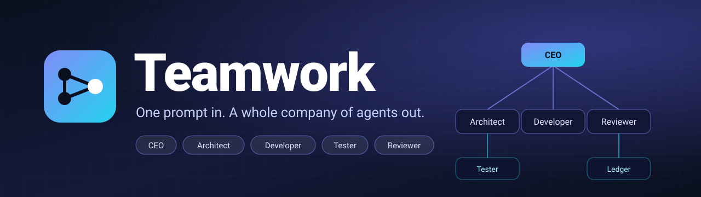
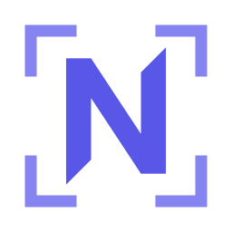
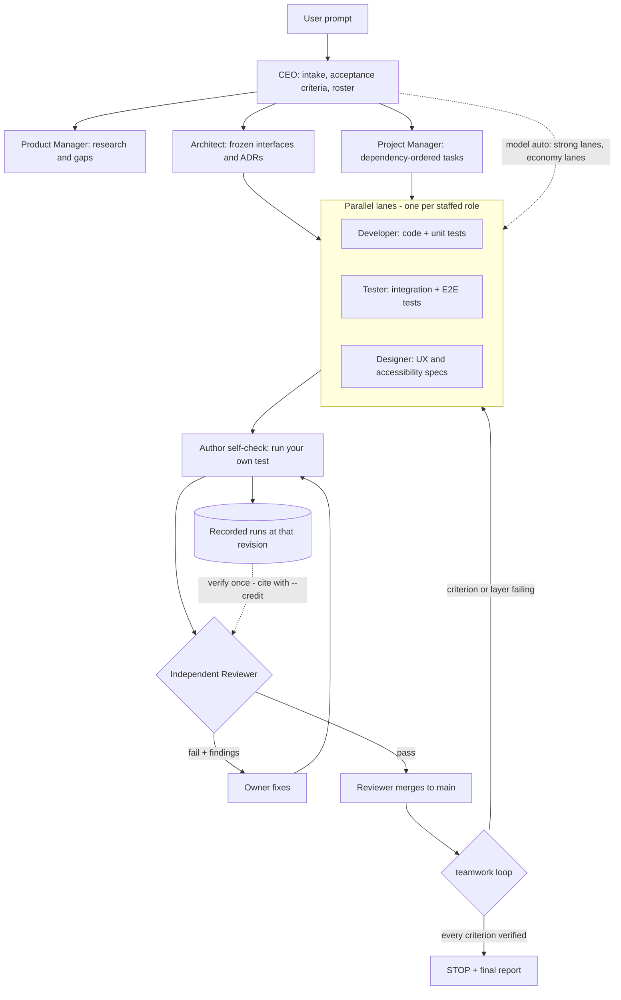

<div align="center">
  
  
  <h1>Nidvue Teamwork</h1>
  <p><strong>One prompt in. A whole company of agents out.</strong></p>
  <p>An autonomous, self-organising multi-agent company for coding agents:<br>
  evidence-gated, role-shared, and auditable by design.</p>
  <p>
    <a href="https://github.com/Nidvue/Teamwork/actions/workflows/ci.yml"></a>
    <a href="LICENSE"></a>
    <a href="docs/Team/Architecture.md"></a>
    <a href="docs/guide/install.md"></a>
    <a href="CONTRIBUTING.md"></a>
    <a href="https://github.com/Nidvue/Teamwork/stargazers"></a>
  </p>
</div>

<p align="center">
  
</p>

Nidvue Teamwork is **a skill for your coding agent** - not a standalone
application. Install it like any other skill (one clone, no package manager), then
ask your agent for the team:

```text
> use the teamwork skill: Build a URL shortener with a CLI, tests and docs
```

That prompt becomes a team of AI agents that plans, builds, tests and
**independently reviews its own work until every acceptance criterion has
executed evidence**. The agent host supplies the LLM API, and **every agent's model
is configured independently** (`teamwork model set <agent>`): a strong model for the
Reviewer, a cheap one for the mechanical lanes. The engine (`teamwork.py`, standard
library only) ships inside the skill and is what the CEO calls; installing it as a package is optional.

## Why Teamwork

| # | Differentiator | What it means in practice |
|---|---|---|
| 1 | **Evidence or `UNVERIFIED`** | A task cannot reach `done` without a recorded `command @revision -> result`. Evidence is a packet - baseline, action, result, hashed artifact, replay - and a bug fix must prove the failure before the fix. `teamwork loop` refuses `STOP` while any criterion or required test layer is unverified. |
| 2 | **Role-shared memory** | Memory and the priority queue belong to the **role**, not the instance (`Roles/Developer/` is shared by `Developer-1..N`). Any role can run several instances, and **one instance at a time revises that role's memory** (`memory claim` / `memory release`), so peers never interleave edits; a lease that runs long is **contested by a peer and ruled by the CTO** (more time, or the lock removed). Agents reuse verified facts instead of re-asking, and the CEO pulse feeds every idle lane. |
| 3 | **Hash-chained audit trail** | Every mutation is appended to `Ledger.jsonl` with `by` / `src` / `rev` provenance. `ledger verify` detects tampering, `trace T-0007` follows a claim end to end, and `ledger export` writes a manifest anyone can check without trusting the team. |

## Features

| Feature | What you get |
|---|---|
| Autonomous org | 15 role charters - CEO, CTO, COO, CFO, Architect, Product Manager, Project Manager, Designer, Developer, Tester, Release Engineer, Technical Writer, Data Engineer, Reviewer, Security Auditor. |
| Two-stage quality gate | The author self-checks with a real test, then a **different** role verifies the artifact against the requirement - what no independent lane verified at that revision - and cites the recorded results it does not repeat. Only the Reviewer may merge. |
| Review throughput | Risk-tiered review packets (`fast`/`standard`/`deep`) that list the records you may cite, `--credit` so a review does not re-run a gate another role already ran at the same revision, a delta re-review after a fail, a profile-aware claim lease (20/40/80 min, capped), `review --next` to claim and packet in one step, priority/age queue ordering, and capacity guidance so the Reviewer queue is not the bottleneck. |
| Parallel lanes | Freeze interfaces first, then developer, tester and designer lanes run concurrently against one frozen contract. |
| Layered tests | Each role designs, builds and runs its own test layer (`unit`, `integration`, `acceptance`, `ui`, `security`, ...); `tests plan` shows coverage and gaps. |
| Designed images | The Designer owns every visual asset, raster **and** vector, and decides what the deliverable needs: vector first (SVG, diagram-as-code), and for a raster `imaging probe` picks the best available text-to-image model (cloud first, else local, else SVG), then plan -> 4+ candidates -> visual review -> improve until it passes -> integrate, with privacy and licence rules. |
| Stop condition as a record | Acceptance criteria are machine records, not checkboxes. The loop stops only when they are all verified. |
| Role-shared state | One memory and one priority queue per role, shared by any number of its instances, with one revising instance at a time (`memory claim`); a private, disposable workspace per instance. |
| Concurrency control | Provider slot leases respect per-provider caps, so N agents never overload a model endpoint. |
| Disputes and tribunal | A challenged design goes through evidence rounds; a 3-round deadlock is ruled on by the CEO + CTO + CFO and recorded. |
| Portable, dependency-free | CPython 3.9-3.13 on Linux, macOS and Windows. **Zero third-party runtime dependencies.** |
| Enforced standards | One canonical toolchain per language, run by the team: `ruff format` + `ruff check` gate CI, `mypy` runs as a non-blocking report (the engine is a tracked post-1.0 typing refactor); the full per-language table is in `references/Engineering.md`. |
| Automatic model routing | `teamwork model auto` detects the running agent host where the environment identifies it and routes the strongest available model to the decision lanes and the economy model to the mechanical lanes - best output where it compounds, lowest cost where it does not. Every lane's model is configurable independently (`model set <agent>`). |
| Clean, modular history | Work commits are rebased and squashed before review, feature work squash-merges into `main`, and the naming policy (PascalCase directories, ecosystem-correct files) is written down rather than argued about. |
| Skill first, engine optional | The product is a skill: `SKILL.md`, role charters, references, templates and the stdlib-only engine in one directory. Any agent host that loads skills or reads `AGENTS.md` runs the same protocol (optional adapter mapping: `references/Adapters.md`); the Python package is only a convenience for driving the engine from a terminal. |
| Remote-agnostic integrity | Branch protection, required checks, squash-only merges and protected `v*` tags are enforced on GitHub, GitLab, Bitbucket, Gitea/Forgejo or Azure DevOps alike. |

## Install the skill

Teamwork is a directory with a `SKILL.md`, the role charters, the references and
the engine - no daemon, no hosted service. **One engine ships behind four
channels**, and each release builds every one of them from the same tagged
revision:

| Channel | Get it with | What you receive | Pick it when |
|---|---|---|---|
| **Skill clone** (the product) | the `git clone` below | `SKILL.md`, the role charters, `references/`, `templates/` and the engine, as plain tracked files | Your agent host loads a skill directory |
| **npm package** | `npm install @nidvue/teamwork`, or your host's own package command | the same skill tree under `skills/teamwork/`, the prompts that ship beside it, and the project notices | Your host resolves skills from the npm registry |
| **GitHub-release wheel** | one command under [Optional: put the engine on your PATH](#optional-put-the-engine-on-your-path) | the Python package: the `teamwork` console script and `python -m teamwork` | You want `teamwork` on your PATH |
| **Source** | `git clone` then `python -m pip install .` | everything, editable | You are working on the engine |

`src/teamwork/version.py` is the one version string behind all four, so no channel
can quietly serve a different engine. What a release publishes, how to read the
version it carries, and what it does not publish: [`docs/releases.md`](docs/releases.md).

Clone it where your agent discovers skills:

| Scope | Path | Use it when |
|---|---|---|
| Project | `.agents/skills/teamwork/` | Commit it so every teammate, session and worktree gets the same protocol |
| User | `~/.agents/skills/teamwork/` | You want the team available in every project |

```bash
# project-local: plain files in your repository, not a nested git repo
mkdir -p .agents/skills
git clone --depth 1 https://github.com/Nidvue/Teamwork.git .agents/skills/teamwork
rm -rf .agents/skills/teamwork/.git

# user-level: keep .git so `git pull` updates the skill
git clone https://github.com/Nidvue/Teamwork.git ~/.agents/skills/teamwork
```

`rm -rf` of the nested `.git` is deliberate: without it git records the skill as a
gitlink (a submodule without `.gitmodules`) and a fresh clone of your project gets
an empty directory. The skill must be plain tracked files. Prefer a submodule?
`git submodule add https://github.com/Nidvue/Teamwork.git .agents/skills/teamwork`
works too - teammates then run `git submodule update --init`.

Any host that discovers skills from a directory reads this one. A host without a
skill loader uses the same protocol through `AGENTS.md` (`teamwork agents-md`).
Exact search paths are host policy, not part of the skill; where a host names its
own skills directory, put the clone there instead. The optional per-host adapter
mapping is in [`references/Adapters.md`](references/Adapters.md).

Re-scan or reload skills in the host, then ask for the team by name:

```text
> use the teamwork skill: <prompt>
```

Where a host exposes skills as slash commands, the same request is
`/teamwork <prompt>`. The host runs the bundled `scripts/teamwork.py` - Python
3.9+, standard library only, no network access, nothing to build.

### Optional: put the engine on your PATH

The skill works without this step. Install the same engine as a package when you
want to drive the team yourself from a terminal, or when your host cannot run a
bundled script.

```bash
# from source (works today)
git clone https://github.com/Nidvue/Teamwork.git
cd Teamwork && python -m pip install .

# the wheel attached to the newest GitHub release; the tag is read, never typed
tag="$(git tag -l --sort=-v:refname | head -1)"
python -m pip install "https://github.com/Nidvue/Teamwork/releases/download/$tag/teamwork_agents-${tag#v}-py3-none-any.whl"
```

That URL names a **release**, and a wheel lags the checkout by design: a version
is bumped in `src/teamwork/version.py` before it is tagged, so the two numbers can
differ. Read both rather than assuming they match:

```bash
tag="$(git tag -l --sort=-v:refname | head -1)"   # the newest published release
python3 scripts/teamwork.py --version              # the version in this checkout
npm view @nidvue/teamwork version                  # the version the npm channel serves
```

The same skill is available from the npm registry as the package
`@nidvue/teamwork`; [`docs/releases.md`](docs/releases.md) describes every face of
a release and what none of them contains.

If you need the tree's exact engine, install from source
(`python -m pip install .`) instead of from a release asset.

#### The package index is not live yet

The distribution name is `teamwork-agents` (the name `teamwork` is taken on
PyPI); the import name and the console script are both `teamwork`. The package is
**not published to PyPI**: `https://pypi.org/pypi/teamwork-agents/json` returns
not-found, so these commands fail for now and are listed only to describe the
channel, not to be run.

<!-- release-consistency: channel-unavailable -->
```console
$ pipx install teamwork-agents        # unavailable: not on PyPI yet
$ uvx --from teamwork-agents teamwork --version   # unavailable: not on PyPI yet
$ python -m pip install teamwork-agents           # unavailable: not on PyPI yet
```

Until the package is published, use the GitHub-release wheel above or install
from source; `python3 scripts/teamwork.py` needs neither. This note is what
`scripts/check_release_consistency.py` rule R8 reads, so the claim and the
package index cannot drift apart again.

## 30-second quickstart

```bash
# 1. install the skill (one clone, nothing to build; drop the nested .git so the
#    skill is committed as plain files, not a submodule)
$ mkdir -p .agents/skills && git clone --depth 1 https://github.com/Nidvue/Teamwork.git .agents/skills/teamwork && rm -rf .agents/skills/teamwork/.git

# 2. in any project, ask your agent for the team
$ cd my-project
> use the teamwork skill: Build a URL shortener with a CLI, tests and docs
```

The CEO takes it from there: it writes `AGENTS.md`, staffs the roster, freezes the
interfaces, records the acceptance criteria and opens the lanes. `init` creates
the hidden, gitignored workspace at `.pi/Teamwork/Teams/<Team>/` and leaves your
project tree untouched. Project output (`AGENTS.md`, code, tests, docs) is
committed; team state is local.

The skill calls the engine for you. When you want to see or steer the machine
yourself, the same run is three commands:

```bash
$ teamwork agents-md     # write or patch the AGENTS.md constitution
$ teamwork map           # the workspace layout, roles and instances
$ teamwork criteria list # the machine records that define "done"
```

Read the full walkthrough in [`docs/guide/quickstart.md`](docs/guide/quickstart.md).

## For agents

If you are the agent reading this repository, not the human who installed it: you
can install and drive this skill yourself. Do the steps in order, and repeat them
safely - every one is idempotent.

### 1. Find the skill directory, then install

A skill is a directory; the only host-specific part is where that directory is
scanned from. Use your host's skills directory if it names one, otherwise the
portable conventions below work.

| Scope | Convention | When |
|---|---|---|
| Project | `.agents/skills/teamwork/` | The team protocol should travel with the repository |
| User | `~/.agents/skills/teamwork/` | The team should be available in every project |

```bash
# already installed? any hit means yes
ls .agents/skills/teamwork/SKILL.md ~/.agents/skills/teamwork/SKILL.md 2>/dev/null

# not installed: clone once into the directory your host scans
mkdir -p .agents/skills
git clone --depth 1 https://github.com/Nidvue/Teamwork.git .agents/skills/teamwork
rm -rf .agents/skills/teamwork/.git   # plain files, not a nested repo
```

### 2. Verify before you promise anything

```console
$ python3 .agents/skills/teamwork/scripts/teamwork.py selftest
teamwork selftest: 5/5 checks passed
```

Use the directory you actually cloned to; the engine is the same in all of them.

Exit `0` means the bundle and the engine are intact. Anything else: report the
failure with the command and its output, and stop. Do not improvise a replacement.

### 3. Follow the skill, from its own directory

1. Read `<skill>/SKILL.md` completely, then `<skill>/roles/<your-role>.md` for the
   role you are acting as.
2. Run `scripts/teamwork.py init --roster slim` (or `standard`/`full`, or
   `--agents` for an exact list; the skill usually does this for you) and
   `agents-md` so the constitution is in place before any work starts.
3. Claim work with `task next <you>`; never sit idle while ready work exists.
4. Record evidence as `command @revision -> result`; submit with `selfcheck`, then
   `pr open`. A different role reviews and merges - you never merge your own work.
5. Stop only when `loop` prints `STOP` and `audit` reports no problems.

Read [`references/Adapters.md`](references/Adapters.md) for the six host
operations, [`references/Concurrency.md`](references/Concurrency.md) for slot
leases and model routing, [`references/Coordination.md`](references/Coordination.md)
for the multi-agent failure modes and the checks that catch them, and
[`docs/guide/quickstart.md`](docs/guide/quickstart.md)
for the workspace layout. Do not read the whole tree first; the skill is written
to be loaded on demand.

### 4. Rules that are not optional

- No claim about code, tests or CI without a recorded command, revision and result.
- Never fake a test run, never merge your own work, never weaken a gate.
- A red line (secrets, force-push, publishing, production calls) is refused and
  recorded with `redline` - then escalated, never executed.
- The user talks to the CEO only. Every other role reports to its manager
  (`teamwork.py map` draws the tree): the CTO for engineering, the COO for
  planning, the Product Manager for requirements and docs. Escalate upward,
  not sideways to the CEO.

## Common ways to use it

The transcripts are trimmed from a real run of the engine in this repository
(paths elided); the prompts in A-C are illustrative.

### A. New project from one prompt

```console
$ cd ~/code/url-shortener
> use the teamwork skill: build a URL shortener - a CLI with shorten and expand,
  SQLite storage, a pytest suite and a README. Keep it dependency-free.
```

The CEO writes `AGENTS.md`, records `AC-1..AC-n`, freezes the interfaces and opens
the lanes. You keep working in the host; the team reports through the CEO.

### B. A feature in an existing repository

```console
$ cd existing-repo
$ mkdir -p .agents/skills && git clone --depth 1 https://github.com/Nidvue/Teamwork.git .agents/skills/teamwork && rm -rf .agents/skills/teamwork/.git
> use the teamwork skill: add per-key rate limiting to the public API - 100
  requests/minute, 429 with Retry-After, and tests that prove the boundary.
```

Committing `.agents/skills/teamwork` gives every teammate the same protocol on a
fresh clone.

### C. A bug or a red CI run

```console
$ cd repo
> use the teamwork skill: fix the failing CI job on main, prove the fix with the
  exact test command, and do not touch unrelated files.
```

The protocol degrades the same way everywhere: without a teammate tool one agent
switches hats, and the evidence gates still hold (`references/Adapters.md`).

### D. Steer the machine yourself

The skill calls these for you; run them when you want to see or change the plan.

```console
$ teamwork init --roster slim          # or: teamwork init --agents ceo,architect,developer-1,tester-1,reviewer-1
$ teamwork criteria add --id AC-1 --text "shorten then expand returns the original URL" --owner developer --by ceo
$ teamwork criteria add --id AC-2 --text "pytest -q passes on the matrix" --owner tester --by ceo
$ teamwork task add developer "Implement shorten/expand with tests" --priority P0
$ teamwork loop

> CONTINUE
  ! 2 acceptance criteria unverified
  ! no layered test records
  ! 1 task(s) not finished
```

### E. Keep the lanes full

```console
$ teamwork pulse --interval 5
$ teamwork parallel

## provider slots
- anthropic        used=0    cap=64    free=64
- deepseek         used=0    cap=2500  free=2500
- ollama-cloud     used=0    cap=64    free=64
- openai           used=0    cap=64    free=64
- TOTAL free slots: 2692

## executable work
- developer        1 ready  next: developer/T-0001 [P0] Implement shorten/expand with tests
```

`pulse --commit` dispatches to idle instances. `parallel` shows how many lanes may
start without exceeding a provider cap. `instance add <role> --count N` scales any
role later without touching the shared memory file:

```bash
# any role, at any point: the instances share one memory set and one queue
teamwork instance add architect --count 2
teamwork instance list

# exactly one instance of a role revises that role's memory at a time
teamwork memory claim architect --by Architect-2 --reason "rewrite the contract"
teamwork memory status architect

# and a lease that runs long is contested, not waited out: the CTO rules
teamwork memory contest architect --by Architect-3 --reason "three tasks are blocked"
teamwork memory extend architect --by CTO --ttl 45 --reason "the rewrite is large"
#   or: teamwork memory revoke architect --by CTO --reason "that lane is wedged"
teamwork memory release architect --by Architect-2
```

### F. Resume after a crash or a new session

All state is on disk, so a fresh agent resumes without a handover meeting.

```console
$ teamwork load developer-1     # the role's short-term memory
$ teamwork task next developer-1
$ teamwork map                  # roles, instances, open work
```

### G. Prove the audit trail to someone who does not trust the team

```console
$ teamwork ledger verify
# Ledger verify (.../Ledger.jsonl)
# records: 5 | head: a23748ba85cf962f
- chain intact, every digest matches

$ teamwork trace T-0001
## task T-0001 [todo] Implement shorten/expand with tests  (developer)
## ledger events (1)
- #0005 task.add  developer  [P0] Implement shorten/expand with tests
```

`ledger export` writes a manifest that a reviewer can verify without access to
the workspace.

### H. Route the models, not just the roles

```console
$ teamwork model auto
- architect          strong   deepseek-v4.1-flash
- ceo                strong   deepseek-v4.1-flash
- developer          economy  deepseek-v4.1-flash
- product-manager    economy  deepseek-v4.1-flash
- project-manager    economy  deepseek-v4.1-flash
- reviewer           strong   deepseek-v4.1-flash
- tester             economy  deepseek-v4.1-flash
# dry run: rerun with --apply to write these into Settings.json
```

Decision lanes get the strongest model the host exposes; mechanical lanes get the
economy one. `model set <agent>` overrides a single lane.

## How it works



Nothing is dispatched before the interfaces are frozen, and nothing reaches
`main` without the Reviewer's own evidence. Everything else runs in parallel.

## Teamwork vs alternatives

| Project | Orchestration model | Evidence gate | Audit trail | Coding-agent skill | Zero runtime deps | License |
|---|---|---|---|---|---|---|
| **Nidvue Teamwork** | Persistent role org: shared role memory, priority queues, parallel lanes, CEO pulse | **Enforced** - `loop` blocks `STOP` until every criterion and required test layer has evidence | **Hash-chained** `Ledger.jsonl`, `ledger verify`, `trace`, `ledger export` | **Yes** - ships `SKILL.md`, `roles/`, `references/`, `templates/` | **Yes** - standard library only | AGPL-3.0 |
| CrewAI | Role-based crews, sequential or hierarchical process | No | Task output and logs, not tamper-evident | No - Python library | No | MIT |
| AutoGen | Event-driven multi-agent conversations | No | Conversation logs, not tamper-evident | No - Python library | No | CC-BY-4.0 (archived) |
| MetaGPT | SOP-driven "software company" pipeline | No | Artifact files, not tamper-evident | No - Python library | No | MIT |
| LangGraph | Stateful graph / state machine over LLM agents | No | Checkpointing, not hash-chained | No - Python library | No | MIT |
| Aider | Single AI pair programmer in the terminal, git-aware | No | Git commits | No - terminal CLI | No | Apache-2.0 |

Competitor facts were checked against each upstream repository and its GitHub
licence metadata on 2026-10-17:

- [crewAIInc/crewAI](https://github.com/crewAIInc/crewAI) - accessed 2026-10-17
- [microsoft/autogen (archived)](https://github.com/microsoft/autogen) - accessed 2026-10-17
- [FoundationAgents/MetaGPT](https://github.com/FoundationAgents/MetaGPT) - accessed 2026-10-17
- [langchain-ai/langgraph](https://github.com/langchain-ai/langgraph) - accessed 2026-10-17
- [Aider-AI/aider](https://github.com/Aider-AI/aider) - accessed 2026-10-17

## Architecture at a glance

One skill, one engine, one workspace format - the package is a thin face on the
same files:

```text
Teamwork/
├── SKILL.md                  # canonical skill entry (the host loads this)
├── roles/ references/ templates/
├── src/teamwork/             # engine, cli, resources, portable
├── scripts/teamwork.py       # compatibility shim, stdlib only
├── tests/{unit,integration,acceptance}/
├── docs/                     # mkdocs site + docs/Team/ project documents
├── assets/                   # banner, logo, terminal demo, social preview
└── .github/workflows/        # ci.yml, release.yml, docs.yml
```

The engine resolves its bundle from `$TEAMWORK_SKILL_DIR`, then the installed
`teamwork/data/`, then the checkout - so it works identically from a git clone
and from a wheel. The frozen contracts live in
[`docs/Team/Architecture.md`](docs/Team/Architecture.md); the design brief for
this README and its visuals lives in [`docs/Team/Design.md`](docs/Team/Design.md).

## Roadmap

| Version | Status | Focus |
|---|---|---|
| `v1.0.0` | released | Package, skill bundle, CLI, 15 role charters, layered tests, CI/release workflows, docs site. |
| `v1.x` | current | A `v*` tag publishes the wheel, the checksums, the SBOMs and the `@nidvue/teamwork` npm package from one revision and rebuilds the site from it ([`docs/releases.md`](docs/releases.md)); the remaining step is PyPI trusted publishing. Read the newest tag with `git tag -l --sort=-v:refname` and the tree's version with `teamwork.py --version`: the two differ by design between a version bump and its tag. |
| next | exploring | More provider adapters, end-to-end worked examples, an opt-in ledger dashboard. |

Direction, not a promise: no hosted service, and stars cannot be bought - this
project optimises the conversion inputs (demo, README, topics, license, releases).

## Contributing, security and license

- **Contributing** - work on your own branch, run `pytest -q` and `ruff check`,
  and open a PR; a Reviewer - never the author - merges it. Read
  [`CONTRIBUTING.md`](CONTRIBUTING.md) and the
  [code of conduct](CODE_OF_CONDUCT.md).
- **Security** - please report vulnerabilities privately via
  [GitHub security advisories](https://github.com/Nidvue/Teamwork/security/advisories/new);
  see [`SECURITY.md`](SECURITY.md).
- **License** - [AGPL-3.0](LICENSE), copyright (C) 2026 **Nidvue** (see [NOTICE](NOTICE)). The strong copyleft is deliberate: this is a
  governance tool, and its audit guarantees should survive modification.
- **No personal data, no local leakage** - a hard project rule: no personal
  names, emails, domains, absolute home paths or credentials in the tree or the
  history, and no agent-host configuration or local working state (`.pi/` auth,
  settings and sessions, virtualenvs, build output, caches). `scripts/privacy_scan.py`
  fails the build on any of them.
  Identity defaults to `agents.nidvue.com` and is overridable with
  `TEAMWORK_IDENTITY_DOMAIN`.

## Star history

<a href="https://star-history.com/#Nidvue/Teamwork&amp;Date">
  
</a>
