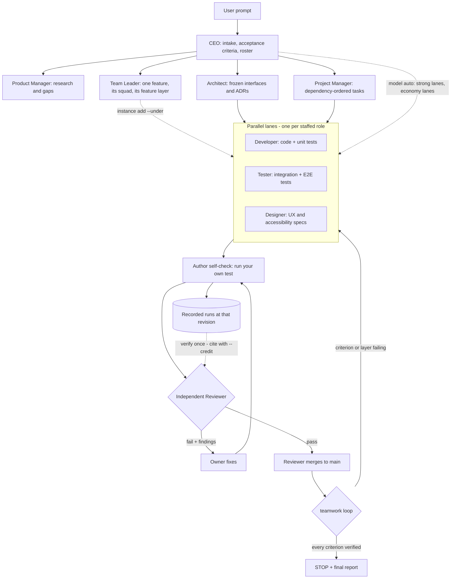

# How it works - Nidvue Teamwork

Owner: Technical Writer.

Related: [Home](../index.md) · [Architecture](architecture.md) · [For agents](for-agents.md) · [Usage patterns](usage.md) · [Operations](operations.md) · [Features](features.md) · [Alternatives](alternatives.md) · [CLI reference](cli.md)

One skill, one engine, one workspace format. This page follows the loop a request
takes, then shows the tree it runs in. The frozen interfaces are in the team's
[Architecture.md](https://github.com/Nidvue/Teamwork/blob/main/docs/Team/Architecture.md);
the shipped package is on [Architecture](architecture.md).

## 1. The loop



Nothing is dispatched before the interfaces are frozen, and nothing reaches
`main` without the Reviewer's own evidence. Everything else runs in parallel.

A **Team Leader** owns one independent feature end to end - the squad it spawns
and coordinates (`instance add <role> --under <leader>`) and its `feature` test
layer - so several features run in parallel without sharing a writable path; the
Architect and the Project Manager stay shared services ([Features](features.md)).
Escalation is one hop: a squad member escalates to its Team Leader, the Team
Leader to the CTO, and a member takes no CTO, CEO or CFO line of its own.
`teamwork map` prints that live team - each leader with its `F-nnnn` and the
instances under it, the unattached squad as the CTO's pool, and the Reviewer,
Security Auditor and CFO as independent lanes that serve every feature without
reporting to a leader.

**Delegation is recursive, and nobody is a leaf by default.** The CEO does not
write the deliverable: it decomposes, dispatches and arbitrates, and every unit of
work goes to a lane. A Team Leader lane fans out into its own squad rather than
building the feature itself, and a lane whose slice will not fit its budget splits
it into sub-tasks and dispatches them the same way (`swarm run` recomputes the wave
from the records, so a lane that spawns work is indistinguishable from a CEO that
does). The chain ends at a small task one lane can finish and verdict inside its
budget - and at an independent verifier: no lane reviews or merges its own work,
and every deliverable gets its owner's self-check, a different role's review, and
its test layer actually run.

## 2. What each stage leaves behind

| Stage | Record | Who owns it |
|---|---|---|
| Intake | `docs/Team/Project.md`, acceptance criteria as machine records (`criteria add`) | CEO |
| Research | `docs/Team/Research.md` with a direct URL and access date per external claim | Product Manager |
| Interfaces | `docs/Team/Architecture.md`, ADRs in `docs/Team/Decisions.md` | Architect |
| Decomposition | dependency-ordered tasks on each role's `TaskQueue.md`; `docs/Team/Plan.md` | Project Manager |
| Feature team | one open `F-nnnn`, its squad and its `feature` test layer | Team Leader |
| Work | code and its unit tests on the task branch | Developer |
| Test layers | `tests run --layer <l> --area <a>` records with a baseline and an artifact | layer owner |
| Self-check | the author's own run, recorded before review | author |
| Review | a verdict with evidence, then the merge; the entry is appended to `docs/Team/Archive.md` | Reviewer |
| Stop | `loop` reads the criteria and test records; `audit` reads the whole trail | CEO |

Because each stage writes a record, a session that ends mid-run loses no decision:
the next agent reads the record, not a conversation.

## 3. The gate, in one paragraph

The author runs a real test and records the command, the revision and the result.
A **different** role then reviews the revision: the requirement, the acceptance
layer, the criteria the packet marks uncovered, and one sampled credit. A pass
merges at once and deletes the branch; a fail returns the task to its owner with
findings. Three failures on one task escalate to a dispute and the tribunal, so
the loop cannot spin. A review may cite a peer's recorded run at the same revision
(`--credit`) instead of repeating it - independence is about the author, not about
running the same command twice.

## 4. Architecture at a glance

```text
Teamwork/
├── SKILL.md                  # canonical skill entry (the host loads this)
├── roles/ references/ templates/
├── src/teamwork/             # engine, cli, resources, portable
├── scripts/teamwork.py       # compatibility shim, stdlib only
├── tests/{unit,integration,acceptance}/
├── docs/                     # mkdocs site + docs/Team/ project documents
├── assets/                   # banner, logo, terminal demo, social preview
└── .github/workflows/        # ci.yml, release.yml, docs.yml
```

The engine resolves its bundle from `$TEAMWORK_SKILL_DIR`, then the installed
`teamwork/data/`, then the checkout - so it works identically from a git clone
and from a wheel. The three faces (skill, package, workspace) and the resolution
order are on [Architecture](architecture.md).

## 5. The workspace the loop writes into

```text
<project>/
├── AGENTS.md                        # team constitution (managed block)
├── docs/Team/                       # committed project output
└── .pi/Teamwork/Teams/<Team>/       # hidden, gitignored
    ├── TeamMap.md  Settings.json
    ├── Criteria.md  Tests.md  TestPlan.md
    ├── Reviews.md  Disputes.md  Skills.md
    ├── Knowledge.md                 # K- records shared by every role
    ├── Ledger.jsonl                 # hash-chained audit trail
    ├── Global/                      # CEO-owned shared memory
    ├── Roles/<Role>/                # shared by every instance; Lessons.md
    ├── Agents/<Instance>/           # private to one instance
    └── Runtime/                     # ephemeral, never committed
        ├── Locks/                   # memory pen, criteria, mailbox, plan
        ├── Slots/                   # provider leases
        ├── Lanes/<run>.json         # one record per lane, survives the CLI
        ├── Mailbox/<Instance>/      # M- records: the agent-to-agent queue
        └── Worktrees/<Instance>/<T-id>/   # one worktree per task branch
```

Project output is committed; team state is local. A second team in the same
repository gets its own `<Team>` tree, named after the project, `--team Name` or
`TEAMWORK_TEAM=Name`, so two teams never share a queue or a ledger.

## 6. Where to go next

- [Usage patterns](usage.md) - the eight recurring jobs as transcripts.
- [Operations](operations.md) - slots, the memory pen, resume, the ledger, routing.
- [Architecture](architecture.md) - package layout, resource resolution, the
  workspace format and the ledger record shape.
- [CLI reference](cli.md) - every command, flag and exit code.
